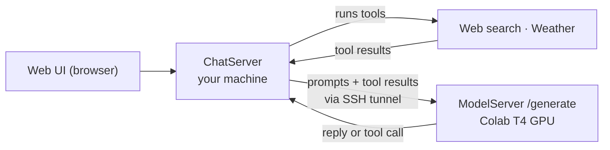

# JERN — Just An Experimental Response Network

**A small personal chat assistant with a cloud-GPU brain.** The language model can run on a free Google Colab GPU; the web UI and its two tools (web search, weather) run on your own machine.

JERN is built on [Saturday](https://github.com/vivek09thakur/SATURDAY), a framework for assistants on small language models: Saturday supplies the model backends, LoRA fine-tuning, the Colab flow and the tool-call loop; JERN adds the persona, the training conversations, the web UI and the tools.


> Experimental by name and by nature. A small model sometimes gets facts wrong or repeats itself. See [Limitations](#limitations).

## How it works

JERN is a small personal AI assistant by Vivek Thakur. It has two models and one app:

| Part | What it is | Where |
|---|---|---|
| **Chat model** | `microsoft/Phi-3.5-mini-instruct` with a LoRA adapter trained on `data/chat/conversations.txt`, so it answers as JERN and knows when to search or check the weather | Saturday (`saturday.models`), configured in `saturday.toml` |
| **Char model** | A from-scratch GPT-style transformer trained character-by-character on the same file (an experiment, not the assistant) | `model/jern/network.py`, `train.py`, `sample.py` |
| **App** | FastAPI server + web UI + two tools (`search_web`, `weather`) | `app/server/`, `app/tools/`, `app/ui/` |

The model can run on this machine or on a Google Colab GPU; the UI and tools always run on this machine.



## What leaves your machine

When the model runs on Colab, **everything the model needs to see is sent to Colab**: your messages and whatever the tools return (search results, weather). If you run the model locally, nothing is sent anywhere.

## Quick start

```powershell
python -m venv venv; .\venv\Scripts\activate
pip install -r requirements.txt
copy .env.example .env                  # HF_TOKEN keeps the trained adapter on the Hub; OPENWEATHER_API_KEY is optional

python main.py                          # web UI at http://127.0.0.1:8000, model on a Colab T4 through an SSH tunnel
python main.py serve --local            # everything on this machine (needs a GPU with ~10 GB for the 3.8B model)
```

The first run trains the LoRA adapter on `data/chat/conversations.txt` (about ten minutes on a T4) and pushes it to
the Hub as `<your-user>/jern-<model>` (private) whenever `HF_TOKEN` is set, so later runs load it instead of training.
A different `--model_name` gets its own repo and trains once; `--train` forces a retrain (do this after editing the
data). Set `HF_REPO` to use a different repo. Any setting in `saturday.toml` can be overridden on the command line:
`python main.py --temperature=0.5 --port=8080`.

## Limitations

- The chat model is small (3.8B). It can repeat phrases, call a tool when it should not, or answer incorrectly.
- Running on Colab depends on free-tier GPU availability and on the Colab CLI and tunnel working on your network.
- The server has no login and listens on `127.0.0.1` only; it is for the person at the keyboard.

## Documents

- [cli.md](docs/cli.md) — every `main.py` command and flag
- [model.md](docs/model.md) — the two models, the data format, training and fine-tuning
- [server.md](docs/server.md) — HTTP API, sessions, the tool-call protocol, writing a tool
- [colab.md](docs/colab.md) — running on Google Colab, the SSH tunnel, TLS behind a proxy

## Contributing

Issues and pull requests are welcome. A good first contribution is a new tool plugin: see [server.md](docs/server.md) for the plugin protocol.

## License

MIT. See [LICENSE](LICENSE).
