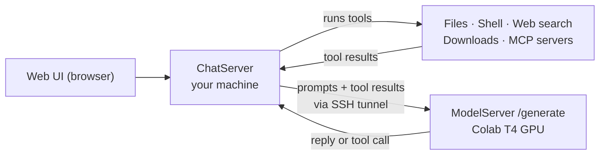

# JERN — Just An Experimental Response Network

**A small personal assistant with a cloud-GPU brain and local hands.** The language model can run on a free Google Colab GPU, while the tools (files, shell, browser, mail, weather, MCP servers) always run on your own machine.

JERN is built on [Saturday](https://github.com/vivek09thakur/SATURDAY), a framework for assistants on small language models: Saturday supplies the model backends, LoRA fine-tuning, the Colab flow and the tool-call loop; JERN adds the web UI, its tools and MCP integration.


> Experimental by name and by nature. A 1.5B model sometimes picks the wrong tool or repeats itself. See [Limitations](#limitations).

## How it works

JERN is a small personal AI assistant by Vivek Thakur. It has two models and one app:

| Part | What it is | Where |
|---|---|---|
| **Chat model** | `Qwen/Qwen2.5-1.5B-Instruct` with a LoRA adapter trained on `data/chat/conversations.txt`, so it answers as JERN and knows how to call tools | Saturday (`saturday.models`), configured in `saturday.toml` |
| **Char model** | A from-scratch GPT-style transformer trained character-by-character on the same file (an experiment, not the assistant) | `model/jern/network.py`, `train.py`, `sample.py` |
| **App** | FastAPI server + web UI + tool plugins (files, shell, web search, downloads, system info, browser, YouTube, maps, weather, email, shutdown, Wi-Fi scan) + any MCP servers you configure | `app/server/`, `app/tools/`, `app/ui/` |

The model can run on this machine or on a Google Colab GPU; the tools **always run on this machine**, so JERN can read your files and run your commands even when the model is in the cloud.



## What leaves your machine

Tools execute locally, but when the model runs on Colab, **everything the model needs to see is sent to Colab**: your messages and whatever the tools return (file listings, file contents, command output). If you run the model locally, nothing is sent anywhere. Do not point a Colab-backed JERN at files you would not upload to Colab.

## Quick start

```powershell
python -m venv venv; .\venv\Scripts\activate
pip install -r requirements.txt
copy .env.example .env                  # HF_REPO/HF_TOKEN keep the trained adapter; tool and MCP keys are optional

python main.py                          # web UI at http://127.0.0.1:8000, model on a Colab T4 through an SSH tunnel
python main.py serve --local            # everything on this machine (needs a GPU for comfort)
```

The first run trains the LoRA adapter on `data/chat/conversations.txt` (about ten minutes on a T4) and pushes it to
`HF_REPO` if set, so later runs skip training. Any setting in `saturday.toml` can be overridden on the command line:
`python main.py --temperature=0.5 --port=8080`.

## Limitations

- The chat model is small (1.5B). It can choose the wrong tool, repeat phrases, or answer incorrectly.
- Running on Colab depends on free-tier GPU availability and on the Colab CLI and tunnel working on your network.
- Shell and file tools act on your real machine. Review any command before approving it.

## Layout

```
main.py                 single entry point (see docs/cli.md)
saturday.toml           identity, persona, model, Colab, tool registry and app settings (Saturday's project file)
constants.py            fixed values that are not settings: paths, site list, MCP timeouts, char-model files
requirements.txt
app/
  server/api.py         FastAPI ChatServer (UI + tools); the model server comes from saturday.models.server
  server/assistant.py   Assistant (Saturday's loop + command rewriting, timeline, terminal sessions), EventLog
  tools/                one file per tool; ToolRegistry (live, local only) and ToolCatalog (descriptions)
  ui/index.html         the web UI (single file, no build step)
model/jern/
  data.py               char-level dataset preparer
  network.py            JERN transformer, Checkpoint
  train.py / sample.py  char-level training and sampling
  config.py / util.py   Configurator, seeding, port helpers (char model and UI)
data/chat/              conversations.txt (training data) + prepare.py
data/contacts.json      (gitignored) people the send_email tool can write to; see contacts.example.json
notebook/               Colab notebook that runs the same pipeline interactively
docs/                   this documentation
export/                 (gitignored) artifacts downloaded from Colab
mcp-servers/            (gitignored) local checkouts of MCP servers not published to npm
```

## Documents

- [cli.md](docs/cli.md) — every `main.py` command and flag
- [model.md](docs/model.md) — the two models, the data format, training and fine-tuning
- [server.md](docs/server.md) — HTTP API, sessions, the tool-call protocol, writing a plugin
- [colab.md](docs/colab.md) — running on Google Colab, the SSH tunnel, TLS behind a proxy

## Contributing

Issues and pull requests are welcome. A good first contribution is a new tool plugin: see [server.md](docs/server.md) for the plugin protocol.

## License

MIT. See [LICENSE](LICENSE).
